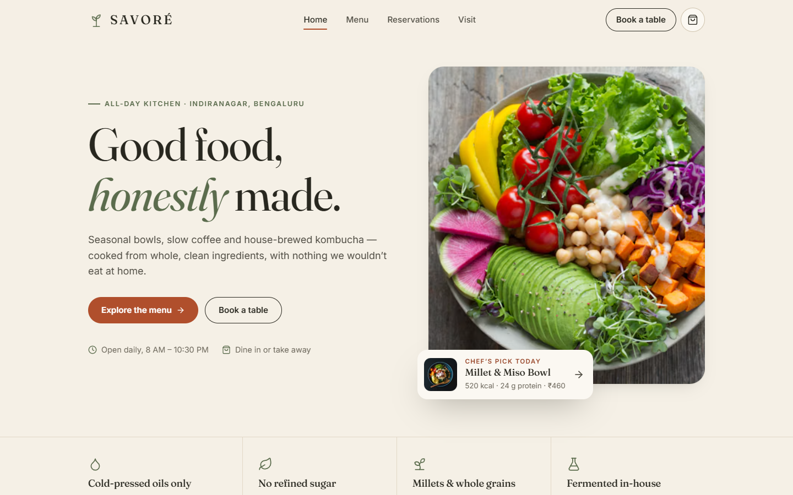
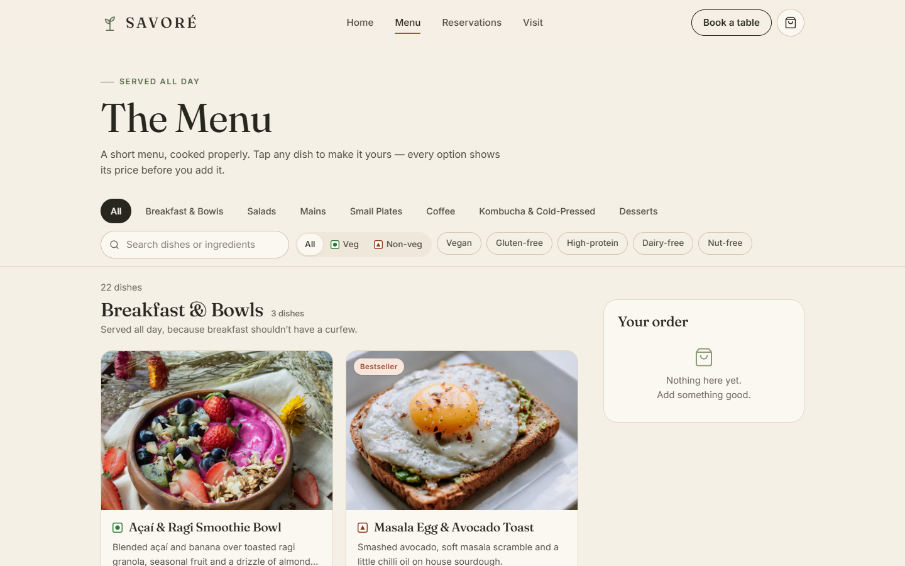
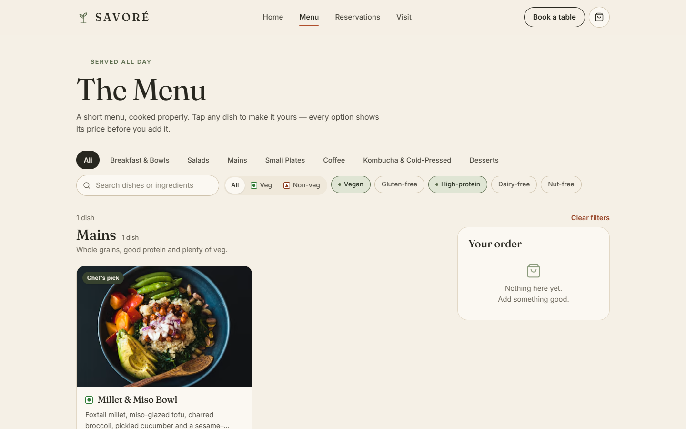
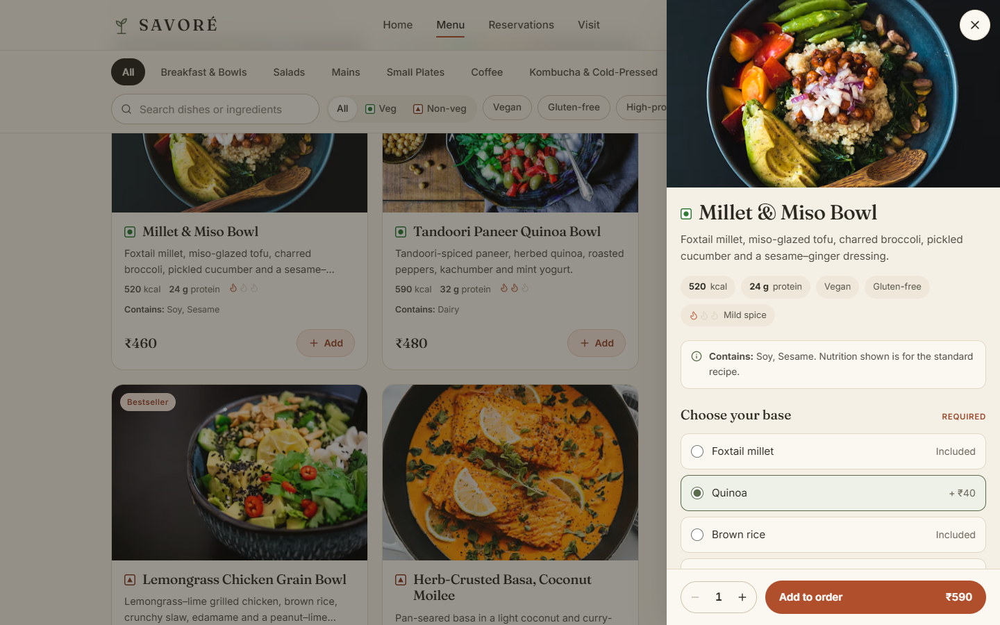
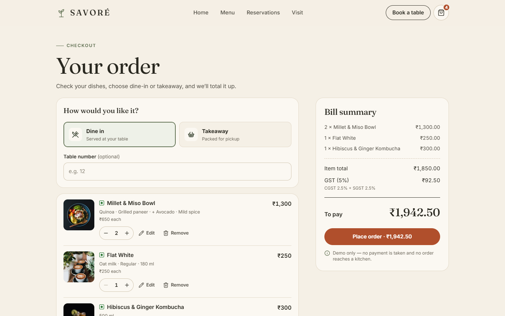
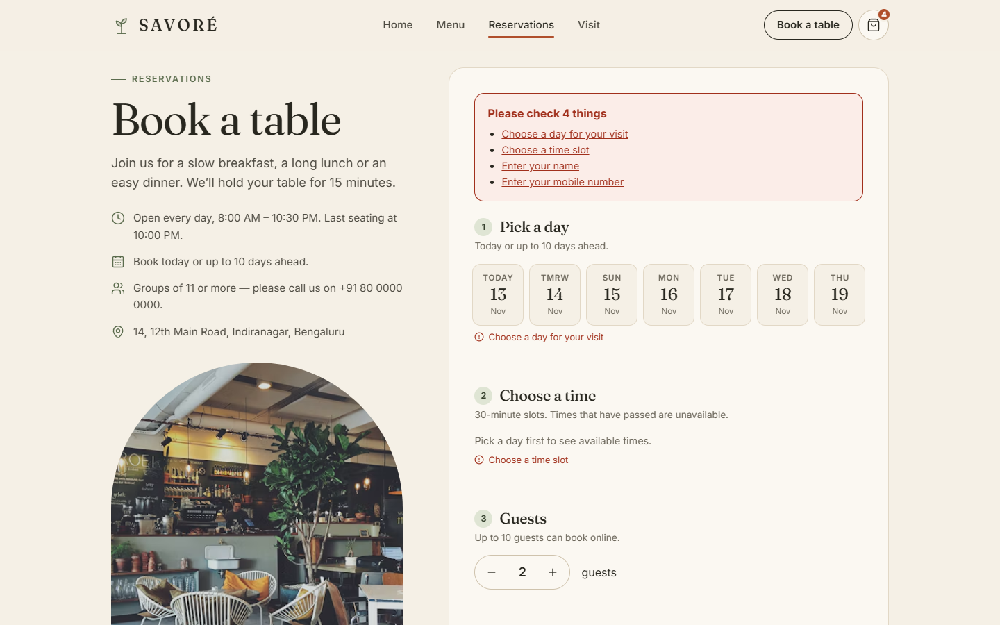
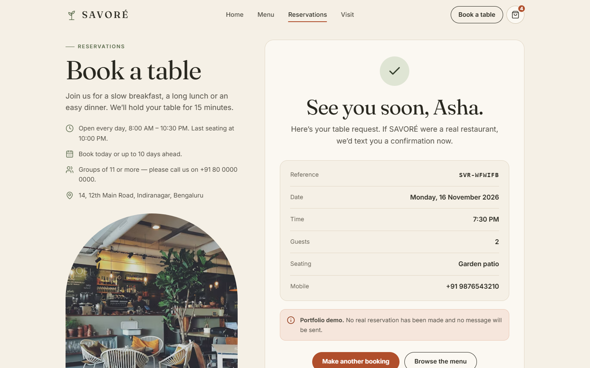
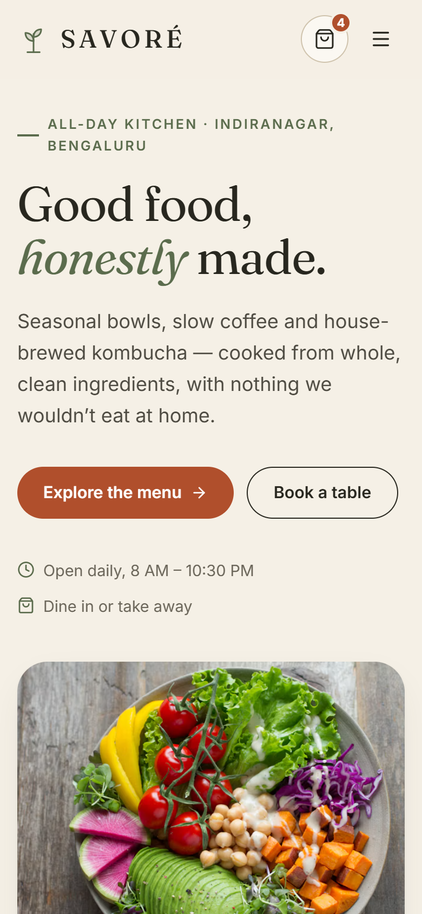
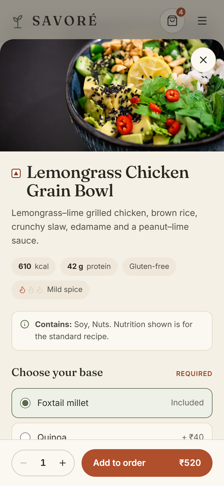
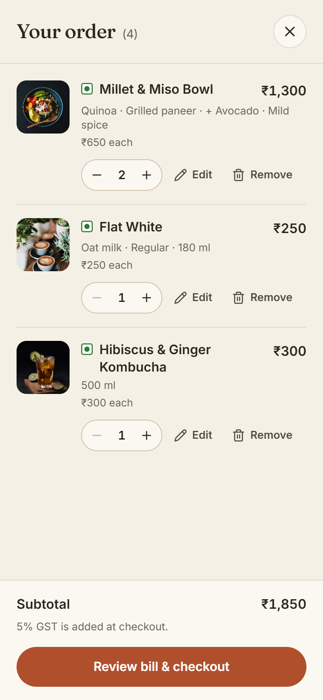

# SAVORÉ — Digital Dining Experience

https://savore-menu.vercel.app/

A restaurant website for **SAVORÉ**, a *fictional* healthy all-day kitchen in Bengaluru. It is a frontend portfolio project built with Next.js, TypeScript and Tailwind CSS: browse an interactive menu, customise dishes, build an order with a live GST bill, and request a table.

> **Demo only.** SAVORÉ is not a real restaurant. No orders are sent, no payments are taken and no reservations are made. The address and phone number are placeholders.



---

## Features

### Interactive menu
- 22 dishes across 7 categories (Breakfast & Bowls, Salads, Mains, Small Plates, Coffee, Kombucha & Cold-Pressed, Desserts)
- Search across dish names, descriptions and categories — accent-insensitive, so “acai” finds “Açaí”
- Veg / non-veg toggle using the familiar Indian green-dot / brown-triangle markers
- Dietary filters: vegan, gluten-free, high-protein (20 g+), dairy-free, nut-free — combined with AND logic
- Every dish shows calories, protein, spice level and allergens; *Chef’s pick* and *Bestseller* badges
- Live result count and a helpful empty state

### Dish customisation
- Required choices (base, protein, bread, milk, size), optional add-ons, spice level and a kitchen note
- Quantity stepper and a price that updates as options change
- Opens in a side drawer on desktop and a bottom sheet on mobile
- Deep-linkable: `/menu?dish=millet-miso` opens that dish directly

### Cart and bill
- Add, remove, change quantities and **edit a dish’s options** from the cart
- Identical customisations merge into one line; different ones stay separate
- Dine-in (optional table number) or takeaway (pickup time)
- Item-wise prices, item total, **5% GST** (shown as CGST 2.5% + SGST 2.5%) and amount to pay — recalculated on every change
- Cart persists across page reloads (localStorage)
- Slide-out cart drawer on every page, sticky order summary beside the menu on wide screens, floating cart bar on mobile

### Table reservations (demo)
- Date chips for today plus the next 10 days; 30-minute slots from 8:00 AM to the 10:00 PM last seating
- Same-day slots less than 30 minutes away are disabled
- 1–10 guests online, with a call-us note for larger groups
- Validation for name, Indian mobile number and optional email, with an error summary that links to each field
- Confirmation screen with a clearly labelled demo reference

### Accessibility
Built in from the start rather than added at the end:
- Semantic landmarks, one `<h1>` per page, skip link and logical heading order
- Native `<dialog>` + `showModal()` for the drawer and customiser (focus containment, Escape to close, background made inert, focus returned to the trigger)
- `<fieldset>` / `<legend>` with native radios and checkboxes; filter buttons expose `aria-pressed`
- Live regions announce result counts, totals and “Added to your order” messages
- `aria-invalid` + `aria-describedby` on form errors; focus moves to the error summary, then to confirmations
- After client-side navigation, focus moves to the new page’s heading
- Visible focus rings, WCAG AA colour contrast, `prefers-reduced-motion` respected, layouts work from 320 px

---

## Tech stack

| | |
|---|---|
| Framework | [Next.js 15](https://nextjs.org/) (App Router) + React 19 |
| Language | TypeScript (strict) |
| Styling | Tailwind CSS v4 with design tokens in `@theme` |
| State | [Zustand](https://github.com/pmndrs/zustand) with `persist` for the cart |
| Icons | [Lucide](https://lucide.dev/) |
| Fonts | Fraunces + Inter via `next/font` |
| Images | `next/image` with a custom Unsplash loader |
| Testing | [Vitest](https://vitest.dev/) unit tests |
| Linting | ESLint (`next/core-web-vitals`, `next/typescript`, full `jsx-a11y` recommended set) |

No backend: menu data is static TypeScript and all state is client-side.

---

## Getting started

**Requirements:** Node.js 18.18 or newer (20 or 22 recommended) and npm.

```bash
git clone <your-repo-url> savore
cd savore
npm install
npm run dev
```

Open [http://localhost:3000](http://localhost:3000).

| Script | What it does |
|---|---|
| `npm run dev` | Start the development server |
| `npm run build` | Production build (all pages are statically generated) |
| `npm start` | Serve the production build |
| `npm run lint` | ESLint, including accessibility rules |
| `npm run typecheck` | TypeScript check |
| `npm test` | Run the Vitest unit tests |

No environment variables are needed.

---

## Project structure

```
src/
├─ app/                 Routes: / , /menu , /cart , /reserve , not-found, layout, globals.css
├─ components/
│  ├─ layout/           Header, footer, logo, focus + cart-rehydration effects
│  ├─ ui/               Dialog, QuantityStepper, DietMarker, SpiceLevel, Toast, Confirmation
│  ├─ home/             Home page sections
│  ├─ menu/             MenuExplorer, DishCard, DishCustomiser, MiniCart
│  ├─ cart/             CartDrawer, CartLineList, CartView (bill + confirmation)
│  └─ reserve/          ReservationForm
├─ data/                menu.ts, categories.ts, restaurant.ts   (typed static data)
├─ lib/                 pricing.ts, filters.ts, reservation.ts, format.ts   (pure, tested logic)
├─ store/               cart.ts (persisted), ui.ts (dialogs, toasts)
└─ types/               Shared TypeScript types
tests/                  Vitest unit tests for pricing, filters and reservations
design/prototype/       The approved static HTML prototype from the design phase
docs/screenshots/       Screenshots used in this README
```

---

## Key technical decisions

- **Money in paise.** Prices are whole rupees in the data; bills are calculated in integer paise and GST is rounded once, avoiding floating-point errors (₹0.1 + ₹0.2 ≠ ₹0.3).
- **Dietary tags are derived, not hand-entered.** “Nut-free”, “dairy-free” and “gluten-free” come from each dish’s allergen list, so a filter can never contradict the label on the dish.
- **Stable cart-line keys.** A line is keyed by dish + sorted options + note, so identical customisations merge regardless of the order options were picked in.
- **Hydration-safe persistence.** The cart is rehydrated from localStorage after the first render, so server and client HTML always match; the cart badge appears only once the saved cart is loaded.
- **Clock-dependent UI renders on the client.** Booking dates, disabled slots and pickup times use the visitor’s current time, so they are computed after mount rather than baked in at build time.
- **One source for business rules.** Opening hours, booking window, guest limit and GST rate live in `src/data/restaurant.ts` and are shared by the UI and the validation.

---

## Testing

- **Unit tests (Vitest):** 33 tests covering option pricing, cart-line keys, bill and GST rounding, filters and search, bookable dates, slot availability, phone normalisation and form validation.
- **Accessibility:** automated axe-core scans (WCAG 2.2 AA + best practices) of every page and interactive state — open dialogs, cart drawer, mobile menu, empty states, form errors and confirmations — at desktop and mobile widths returned no violations at the time of testing.
- **Keyboard:** a scripted keyboard-only walkthrough of every flow (skip link, filters, dialogs, steppers, date/time radios, error links, confirmations).
- **Responsive:** checked for horizontal overflow at 320, 390, 768, 1024 and 1440 px.

Not yet done: a manual pass with a screen reader (NVDA / VoiceOver / Narrator) and testing in Safari and Firefox.

---

## Deploying to Vercel

1. Create an empty repository on GitHub, then push this project:
   ```bash
   git remote add origin https://github.com/<your-username>/savore.git
   git push -u origin main
   ```
2. In [Vercel](https://vercel.com/new), choose **Import Git Repository** and select the repo.
3. Keep the detected defaults (Framework: Next.js, build command `npm run build`). No environment variables are required.
4. Deploy. Every later push to `main` redeploys automatically.

---

## Screenshots

| | |
|---|---|
|  Menu |  Dietary filters |
|  Dish customisation |  Cart and GST bill |
|  Reservation validation |  Demo confirmation |

<p>
  
  
  
</p>

---

## Possible next steps

- Real ordering and booking with a backend (e.g. route handlers + a database) and payment integration
- Availability-aware time slots and table capacity
- Order history and saved favourites
- Playwright end-to-end tests in CI

---

## Credits

- Food and interior photography from [Unsplash](https://unsplash.com/) under the Unsplash License
- Icons by [Lucide](https://lucide.dev/)
- Typefaces: [Fraunces](https://fonts.google.com/specimen/Fraunces) and [Inter](https://fonts.google.com/specimen/Inter) (SIL Open Font License)

SAVORÉ, its menu, address and phone number are fictional and created for this portfolio project.
